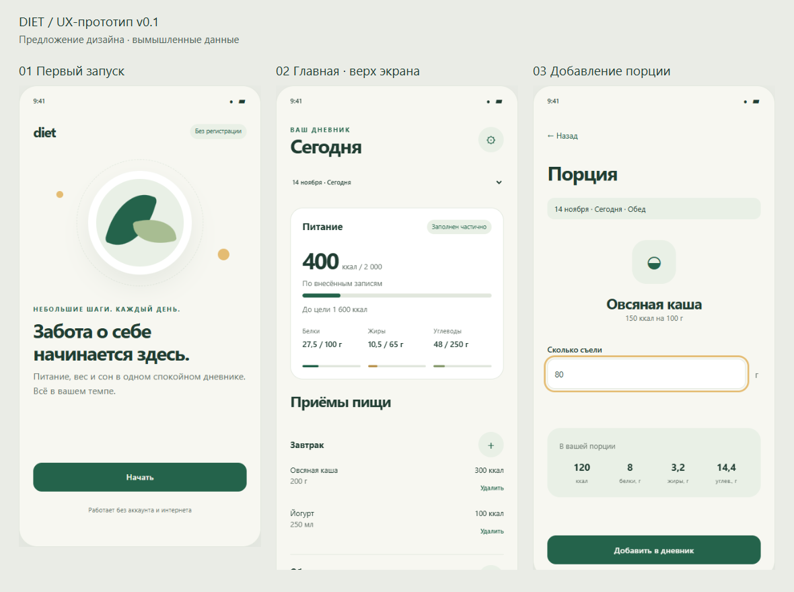

# Diet — UX-прототип v0.1

Дата: 14 ноября 2026 года. Статус: **предложение для проверки интерфейса**, не утверждённый дизайн и не Android-приложение.

## Как открыть

Открыть [index.html](index.html) в браузере двойным щелчком. Установка, сервер и интернет не нужны. GitHub показывает исходный файл; чтобы пройти сценарии, используйте локальный файл или скачайте его и откройте в браузере. Публикация в репозитории не означает размещение работающего сайта.

Данные вымышленные. Не вводите реальные сведения: макет предназначен для обсуждения UX. Изменения живут только в памяти открытой страницы; перезагрузка возвращает начальное состояние. Отказ от постоянного хранения — ограничение этого макета, а не изменение требований приложения.

## Что проверяем

| Сценарий | Связь с требованиями | Задача при просмотре |
|---|---|---|
| Первый запуск | UX-01A/B, UX-03; FR-001/003/005 | Начать без аккаунта, пропустить анкету и цели либо заполнить ручные КБЖУ. Проверить понятность возврата и ошибок. |
| Главная | UX-07A; FR-009/013/014 | Отличить отсутствие еды от нуля, отсутствие цели от цели 0, частичный день от завершённого. Найти дату и добавление еды. |
| Добавление еды | UX-04A; FR-006/008 | Найти продукт, задать порцию, увидеть КБЖУ до сохранения и результат в выбранном дне/приёме пищи. |
| Варианты ввода | UX-04A | Создать свой продукт или внести КБЖУ всей порции через быстрый ввод. Пустое поле не должно становиться нулём. |

Подробные правила остаются в [пользовательских сценариях](../user-flows.md) и [ТЗ](../product-spec.md); этот файл описывает только границы прототипа.

## Визуальное предложение

- Тёплый нейтральный фон, зелёный акцент, читаемые числа КБЖУ; светлая и тёмная темы.
- Один основной мобильный экран; внешние переключатели макета позволяют вернуться к началу, открыть пример дня и увеличить текст.
- Вымышленное «сегодня» — 14 ноября 2026 года. Переключение даты служит проверке выбранного дня, а не подключается к часам устройства.
- Нейтральные формулировки и явные состояния вместо оценки пользователя. Полнота дня не зависит от дефицита или достижения цели.

## Маршруты просмотра

1. «Сначала» → начать → пропустить анкету → отложить цели. На главной должны быть «Цель не задана» и отсутствие записей, без процентов выполнения.
2. Добавить продукт с базой на 100 г, ввести 80 г, сверить предварительные КБЖУ и сохранить. День становится частичным; строка появляется в нужном приёме пищи.
3. Вводить пустое, отрицательное и дробное количество с запятой; проверить ошибки и отсутствие ложного сохранения.
4. Открыть быстрый ввод, заполнить четыре КБЖУ, сохранить. Проверить, что значения относятся ко всей порции.
5. Переключить дату и убедиться, что записи предыдущей даты не переносятся. Вернуться в исходную дату.
6. Включить «Пример дня», проверить цели, полосы БЖУ, завершение дня и возврат к частичному состоянию.
7. Повторить главную и порцию в тёмной теме, на узком окне и с крупным текстом.

## Границы достоверности

- Пересчёт порций иллюстрирует арифметику ТЗ; продукты и цели демонстрационные, не справочник и не рекомендации. Округление макета не утверждает политику расчётов приложения.
- Не проверяются: постоянное хранение, перезапуск Android, аварии записи, синхронизация, системные разрешения и клавиатура реального телефона.
- Вес, сон, аналитические графики, полноценный справочник/редактор рецептов и другие разделы вне трёх основных сценариев обозначены как границы макета. Они не должны сообщать об успешной операции, которая не выполнялась.
- Сохранение черновика после закрытия приложения, расчёт рекомендаций и конфликты целей требуют будущего проектирования и реализации.
- Макет не выбирает Kotlin/Compose/Room или веб-технологии для приложения. Код в index.html обслуживает только демонстрацию интерфейса.
- По решению пользователя от 14 ноября 2026 года резервные копии и восстановление исключены из продукта. Кнопка восстановления удалена с первого экрана; снимки первого запуска и обзор обновлены. Обычное локальное хранение и сохранение черновиков остаются требованиями будущего приложения.

## Решения после просмотра

Подтвердить или скорректировать визуальное направление, возможность отложить цели, расположение даты/действий, форму порции и обязательность всех четырёх КБЖУ. Новые детали не становятся согласованными только потому, что показаны в макете.

## Просмотр и результаты проверки

Главная на обзоре показана частично; полные снимки, проверенные сценарии и ограничения — в [отчёте проверки](validation.md). Интерактивный макет открывается через [index.html](index.html).
