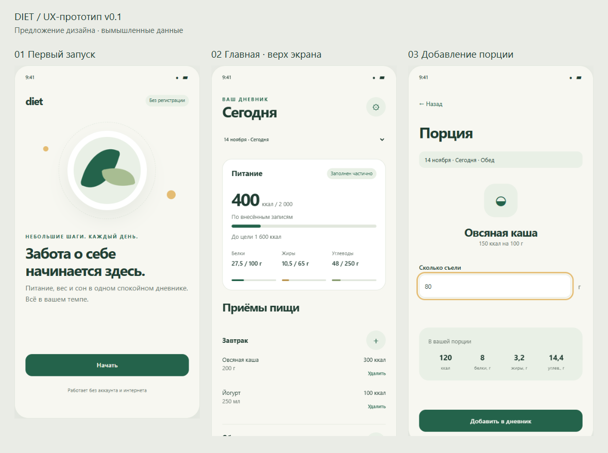

# Проверка UX-прототипа v0.1

Дата: 14 ноября 2026 года. Проверенный артефакт: [index.html](index.html), коммит `1f66004`.

Результат: **36 браузерных проверок пройдены**, критичных незакрытых замечаний независимого ревью в рамках трёх сценариев нет. Это проверка дизайн-макета, не приёмка Android-приложения и не утверждение UX пользователем.

## Среда и метод

- Отдельный headless Microsoft Edge через Playwright, без пользовательского браузерного профиля; локальный file URL, без установки зависимостей в репозиторий.
- Основной viewport 1280 × 1000; узкие 360 × 900 и 320 × 900. Переключатель «Крупный текст» увеличивает базовый текст макета с 16 до 20 px; это не проверка системного масштабирования Android.
- Клики, ввод и выбор даты выполнены через браузерные элементы. Итоги сверялись с видимым текстом и демонстрационным состоянием в памяти. Собраны ошибки страницы и внешние HTTP-запросы: оба списка пусты.
- Статическое ревью требований и исходника выполнено отдельным агентом; визуальный просмотр и итоговая интеграция — координатором.
- Снимки сделаны после отключения переходной анимации, чтобы не сохранять промежуточные цвета темы. Обзор объединяет реальные снимки; главная показана сверху с обрезкой, полная версия доступна отдельно.

## Выполненные проверки

| Группа | Проверки и результат |
|---|---|
| Первый запуск и цель — 4 | Пустая цель недоступна для сохранения; пропуск не создаёт цель; без цели нет полосы выполнения; частичный ввод сохраняется при возврате в форму в той же странице. |
| Поиск и порция — 6 | Поиск без совпадений; видимые дата и приём пищи; запрет пустого/отрицательного количества; 80 г дают 120 ккал, Б8/Ж3,2/У14,4; запись сохраняется в выбранном дне/приёме. |
| Полнота и удаление — 7 | Новая еда создаёт частичный день; завершение только явно; удаление последней записи предупреждает о снятии отметки; отмена сохраняет строку; успешное удаление снимает статус; отмена подтверждения пустого дня сохраняет пропуск; подтверждение даёт видимый ноль. |
| Варианты ввода и даты — 9 | Быстрая запись за вчера; введённая HTML-разметка отображается текстом; сегодняшний день отделён; 1,5 штуки = 180 ккал; 250 мл = 100 ккал без перевода в г; неизвестный БЖУ блокирует сохранение; создание продукта не добавляет еду; ручная цель сохраняется; сегодняшняя цель не появляется вчера. |
| Узкий экран и возврат — 7 | Главная 360 px с крупным текстом без горизонтального переполнения; главная 320 px без выхода карточек/полей/кнопок/статуса за экран; добавление из нижнего приёма открывается сверху; выход с изменённой порцией требует подтверждения; отмена выхода сохраняет количество; порция не переполняется на 360 и 320 px. |
| Границы демонстрации — 3 | Перезагрузка сбрасывает макет; внешних HTTP-запросов нет; ошибок JavaScript нет. |

Дополнительно проверены UTF-8 и локальные ссылки документов, синтаксис встроенного JavaScript и git diff --check. Реальные записи здоровья, ключи и резервные копии в артефактах отсутствуют; все данные примеров синтетические.

## Исправления до публикации макета

- Статус «Заполнен частично» переносится при нехватке места.
- Смена экрана прокручивает к началу мобильного макета; обновление поля не сбрасывает прокрутку.
- Приёмы пищи расположены перед весом и сном, чтобы добавление еды находилось выше.
- Треки БЖУ выровнены при переносе чисел и единиц с крупным текстом.
- Выход из изменённой формы порции запрашивает подтверждение; отмена сохраняет ввод.

## Снимки

- [Первый запуск](previews/onboarding.png), [дневник без цели и записей](previews/home-empty.png).
- [Главная полностью](previews/home.png), [добавление порции](previews/add-food.png).
- [Тёмная главная](previews/home-dark.png).
- [Главная 360 px, крупный текст](previews/home-narrow-large.png), [главная 320 px, крупный текст](previews/home-320-large.png).
- [Порция 360 px, крупный текст](previews/portion-narrow-large.png).

## Пользовательский проход — 14 ноября 2026 года

Пользователь сообщил: «Открыл прототип, прошёл первый запуск и добавил еду. Всё работает». Зафиксирован успешный самостоятельный проход этого маршрута без сообщённых проблем. Конкретные введённые значения, выбранные варианты целей, тема и размеры окна не сообщались и не предполагаются.

Это подтверждение работоспособности проверенного пользователем маршрута макета. Оно не означает приёмку Android-приложения, всех граничных случаев или окончательное утверждение визуального дизайна и всех предложенных правил. Пользователь поручил продолжать проектирование и повторил запрет на код приложения.

## Что остаётся проверить

С пользователем: визуальное направление, понятность целей и полного набора КБЖУ, расположение действий, тексты пустых состояний. На реальном Android после отдельного разрешения на реализацию: системная клавиатура, системный крупный шрифт, TalkBack, перезапуск, хранение и ошибки записи. Контраст и работа со скринридером не проходили инструментальный аудит доступности.

Расчётные рекомендации, полнофункциональные рецепты/копирование и редактирование исторической порции не считаются реализованными или проверенными этим макетом. Добавление форм веса/сна и аналитических графиков, их отдельные проверки отмечаются ниже. Полный список границ — [README прототипа](README.md).

## Изменение объёма — 14 ноября 2026 года

Пользователь исключил резервные копии и восстановление из продукта. С приветствия удалена кнопка-заглушка «Восстановить копию»; маршруты первого запуска, главной и добавления еды сохранены. Снимок первого запуска и общий обзор обновлены под текущий экран. Первоначальные 36 проверок выше относятся к указанному исходному коммиту, а не автоматически к каждой следующей версии макета.

После удаления выполнены восемь целевых браузерных проверок в отдельном headless Edge: отсутствие кнопки восстановления, наличие «Начать», проход без анкеты/целей на главную, расчёт порции 80 г = 120 ккал, сохранение в обед, отсутствие горизонтального переполнения приветствия на 320 px, отсутствие внешних HTTP-запросов и ошибок JavaScript. Все пройдены; синтаксис встроенного JavaScript также проверен. Обновлённые два снимка просмотрены визуально. Остальные снимки не менялись. Запуск браузера в обычной изоляции завершился ошибкой до открытия страницы; проверка выполнена через штатный механизм разрешений без пользовательского профиля.

## Запись веса — 14 ноября 2026 года

Для добавленной формы UX-05A независимый проверяющий выполнил 35 браузерных проверок в отдельном headless Edge. Все пройдены: недопустимый ввод не сохраняется, запятая/точка и обе сотые сохраняются, повторный ввод исправляет одну запись, дата фиксирована, отмена выхода и удаления сохраняет прежнее состояние, вчера отделено от сегодня, питание/полнота/цели/профиль не изменяются. Проверены перезагрузка с обнулением демонстрации и 320 px с тёмной темой и крупным текстом. Ошибок JavaScript и внешних HTTP-запросов нет.

Новые снимки: [форма веса](previews/weight.png) и [редактирование на 320 px, тёмная тема, крупный текст](previews/weight-320-dark-large.png). Проверяющий просмотрел форму и результат в двух вариантах; координатор дополнительно просмотрел оба включённых снимка. Наложений или обрезания не обнаружено. Прежние снимки общего маршрута выше относятся к предыдущим этапам проверки.

Синтаксис JavaScript, diff, UTF-8, ссылки и ID проверены. Обычная изоляция блокировала запуск Edge до открытия страницы; проверка пройдена через штатный механизм разрешений без пользовательского профиля. Средние, графики, реальные ошибки записи, полночь/часовые пояса и постоянное хранение не проверялись: даты макета фиксированы, данные только в памяти. Это не выполнение всех WT-сценариев будущего приложения.

## Запись сна и совместный проход — 14 ноября 2026 года

После добавления UX-05B независимый проверяющий выполнил 43 браузерные проверки. Все пройдены: обязательность обоих полей, целочисленный ввод и минуты 0–59, предварительный итог, подтверждение и отмена нулевой длительности, исправление одной записи, фиксированная дата, отмена выхода/удаления, независимость двух дат и остальных данных. Пустое не превращается в ноль; суточный медицинский предел не вводится. Перезагрузка сбрасывает демонстрацию. Ошибок JavaScript и внешних HTTP-запросов нет.

С чистого первого запуска пройден общий маршрут: ручная цель → обед, 80 г продукта = 120 ккал → вес 80,20 кг → сон 7 ч 30 мин. Правки сна сохранили вес, питание, цели и полноту дня. Проверка на 320 px в тёмной теме с крупным текстом не выявила переполнения. Проверяющий просмотрел пять снимков; координатор дополнительно просмотрел включённые в репозиторий [форму сна](previews/sleep.png), [редактирование на узком экране](previews/sleep-320-dark-large.png) и [подтверждение нуля](previews/sleep-zero-confirmation.png).

Проверки синтаксиса, diff, ссылок, UTF-8 и ID пройдены, независимое ревью замечаний не выявило. Headless Edge запускался через штатный механизм разрешений без пользовательского профиля. Реальное хранение, Android-клавиатура, изменения часового пояса, средние WT/SL и графики не реализованы и не проверялись. Число 43 относится к текущим целевым проверкам, прежние наборы 36/8/35 не объявлены полностью повторно выполненными.

## Игровые названия и их отключение — 14 ноября 2026 года

Независимый проверяющий выполнил 59 проверок в headless Edge: синтетические граничные значения для семи названий веса и четырёх сна, null/0, UI сохранения/отмены/удаления, выбранная дата, выключение/включение и редактирование при выключенных подписях, независимость питания/полноты/целей. Проверены native switch, списки диапазонов, перезагрузка и 320 px с крупным текстом в обеих темах. Все пройдены; JS-ошибок и HTTP-запросов нет.

Проверяющий просмотрел три снимка; координатор дополнительно просмотрел включённые [карточки с названиями](previews/game-names.png) и [настройку на 320 px](previews/game-names-settings-320.png). Существенных замечаний нет. Синтаксис JavaScript, diff, UTF-8, ссылки и ID пройдены. Эти проверки не включают уровни дневника: они добавляются следующей правкой. Системное хранение, Android, часовые пояса и средние не проверялись.

## Уровни дневника — 14 ноября 2026 года

Пройдены 55 независимых проверок: UI-переходы от нуля к одной и двум заполненным датам, обратный пересчёт, повторные отметки без накопления, частичный и подтверждённый пустой день, удаление последней еды, независимость веса/сна/КБЖУ, выбранная дата, два переключателя и доступ к настройкам при обоих выключенных. Все семь порогов и соседние значения проверены на временных синтетических наборах в памяти без добавления фиктивной истории в начальные данные. На максимуме не показан несуществующий следующий уровень.

Короткая регрессия форм и названий, 320 px с крупным текстом в обеих темах пройдены; JS-ошибок и HTTP-запросов нет. Проверяющий и координатор просмотрели [главную](previews/diary-level.png) и [полные настройки на 320 px](previews/game-settings-320-dark-large.png), существенных замечаний нет. На снимке главной одна дата подтверждена пустой, другая заполнена с едой; N = 2 соответствует предложенному правилу, а не дополнительной награде за отсутствие еды.

Синтаксис, diff, ссылки, UTF-8 и ID пройдены; статусы документации согласованы с макетом. Проверки относятся к представлению и вычислению в памяти страницы, не к хранению Android, смене часового пояса или приёмке приложения. Предыдущие наборы проверок не объявлены полностью повторно выполненными.

При итоговом визуальном просмотре координатор заметил, что короткая подпись «Соня» и действие редактирования могли стоять вплотную в одной строке. Кнопки карточек веса/сна размещены отдельной строкой слева. После CSS-правки пройдены 10 целевых проверок коротких/длинных подписей, 320 px с крупным текстом в обеих темах, открытия форм и неизменности данных; JS-ошибок нет. Главный снимок обновлён и просмотрен; основные 55 проверок заново не заявляются.

## Экран прогресса: вес и сон — 14 ноября 2026 года

Независимо подтверждены 50 целевых проверок: 41 UI/интеграционная и 9 синтетических расчётных/календарных. Это проверка HTML-макета в headless Edge, без профиля пользователя и реальных данных. Старые наборы целиком не повторялись.

- Средние недели 8–14 ноября: 79,98 кг и 5 ч 54 мин, по 5 из 7 дат. Для 13–14 ноября — 79,96 кг и 7 ч 30 мин. Проверены пустые/одиночные выборки, подтверждённый нулевой сон, округление половины вверх и точное суммирование больших допустимых измерений.
- Проверены включительные периоды, високосная дата, 366/367 дней, невалидный/обратный/будущий диапазон, общий календарь дневника, переход из точки к дню, исправление/удаление и возврат с сохранённым периодом. Чтение графиков не создаёт записи и не меняет полноту/уровень. Короткая регрессия охватывает ввод еды, измерений и игровые настройки с новым календарём.
- Дату точки можно выбрать через native поле с клавиатуры, включая переход между сегментами. Пропуски разрывают линии, ноль виден, крайние подписи не перекрываются при 320 px и крупном тексте в обеих темах; проверены также большие значения шкалы. Есть точные детали и текстовая таблица.
- JS-ошибок и внешних HTTP-запросов нет. Синтаксис JavaScript и diff проверены. Синтетическая проверка дат не является проверкой системного календаря/часового пояса Android. Хранение, TalkBack и реальный телефон не проверялись.

Снимки: [вес](previews/progress-weight.png), [сон с подтверждённым нулём](previews/progress-sleep.png), [вес на 320 px в тёмной теме с крупным текстом](previews/progress-weight-320-dark-large.png). Координатор просмотрел их и выявил слабую видимость native иконки календаря в тёмной теме. Исправлен color-scheme; 5 целевых проверок темы, раскладки, среднего и клавиатурного выбора прошли. Тёмный снимок обновлён и повторно просмотрен, открытых замечаний нет.

## Экран прогресса: питание и цели — 14 ноября 2026 года

Пройдены 49 независимых целевых проверок: 43 UI/интеграционные и 6 синтетических. Использован headless Edge без профиля пользователя. Полный набор предыдущей фазы не повторялся; выполнена короткая регрессия веса, сна и периодов.

- Все четыре показателя совпали с эталоном 6.9 ТЗ: среднее N=4/7 и отдельные средние факта/цели по Q=3. Проверены заполненное питание, частичная запись, отсутствие данных, подтверждённый ноль, отсутствие цели и нулевая цель БЖУ.
- Фильтр скрывает частичные точки, сохраняя N/Q, средние, записи и уровень. Цель берётся из истории, в том числе до начала выбранного диапазона, и меняется ступенью в нужную дату. UI-переход в дневник, изменение полноты/удаление еды и возврат пересчитывают питание. Быстрый ввод и создание своего продукта прошли короткую регрессию.
- Календарь цели принимает прошлую/будущую дату; будущая цель не меняет сегодняшний результат. Несохранённые поля и дата возвращаются после выхода, включая ON-003. Действующая цель предзаполняется только при отсутствии такого черновика.
- Синтетические случаи: 0,04 + 0,04 отображается как 0,1 после суммирования; среднее 0,3 и 0,6 — 0,5. Переполнение явно обозначено, не превращено в ноль/пропуск и не создаёт NaN/Infinity в SVG. Если среднее ещё представимо, оно может вычисляться точно даже при непредставимой дневной сумме; проблемная дата сохраняет явное сообщение.
- На 320 px в обеих темах с крупным текстом перекрытий нет; у частичных дней отдельная форма маркера, есть легенда, точные детали и текстовые значения. JS-ошибок и внешних HTTP-запросов нет. Это проверка демонстрации, не приёмка Android, хранения, расчётных рекомендаций или доступности TalkBack.

Снимки: [питание](previews/progress-food.png), [питание на 320 px в тёмной теме с крупным текстом](previews/progress-food-320-dark-large.png). До публикации пунктир цели и его легенда сделаны контрастнее. Пройдены 6 целевых проверок цвета в обеих темах, ступеней/одиночной цели, раскладки и неизменности N/Q/средних. Оба снимка обновлены и просмотрены независимо и координатором; открытых замечаний нет.

## Завершение: профиль и приёмы пищи

41 независимая проверка PASS в standalone headless Edge: поля/направление, допустимость значений, отмена черновика, темы, добавление/переименование/порядок/архив приёмов, защита последнего активного приёма и экранирование текста. Сравнение полных days/targets подтвердило отсутствие изменения истории. JS-ошибок и HTTP-запросов нет. Снимки [профиля](previews/profile.png) и [приёмов на 320 px dark/large](previews/meals-320-dark-large.png) просмотрены независимо и координатором; переполнений нет. Это QA макета, не Android-хранения.

## Завершение: продукты и снимки

46 независимых проверок PASS: CRUD, три базы единиц, избранное/недавние, поиск/пустота, FD-001–003 и FD-007, старые 120 ккал против новых 160 после изменения источника, глубокая независимость снимков, удаление источника, отмена, переполнение и сохранение полноты дня. Ревью выявило неэкранированное имя порции; оно исправлено и проверено нейтральной HTML-меткой. JS-ошибок/HTTP нет. Снимки [справочника](previews/catalog.png) и [порции на 320 px](previews/portion-320-dark-large.png) просмотрены, переполнений нет.

## Завершение: рецепты

44 независимые проверки PASS. FD-005: целое блюдо 380/25/10/48, на 100 г — 152/10/4/19,2, порция 50 г — 76/5/2/9,6. Проверены смешанные единицы, отдельный выход, валидация/переполнение, редактирование/удаление источников, независимость рецепта и старых порций, явное обновление базы с новым количеством, отмена, фильтр/избранное и запрет вложенности. JS-ошибок/HTTP нет. Снимки [рецепта](previews/recipe.png) и [редактора на 320 px](previews/recipe-320-dark-large.png) просмотрены, layout без переполнения.
