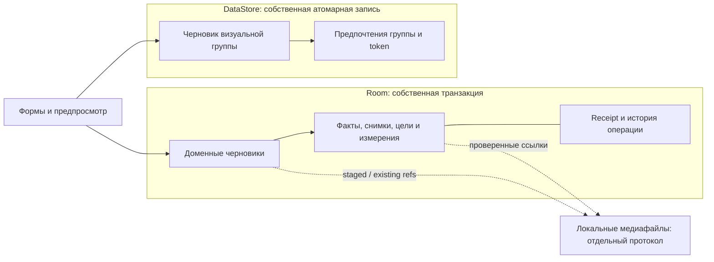

# Diet — логическая модель хранения

Дата: 15 ноября 2026 года. **Статус: инженерный выбор по поручению в рамках этапа 0; не реализовано.** Это логические сущности, ограничения и границы операций, не SQL/DDL, Room-классы или созданная база. Применяется выбранная ветка Room 2.8.5 с BundledSQLiteDriver 2.7.1 из [каталога зависимостей](android-dependencies.md); пакет/примеры Room 3 не смешиваются с ней.

Источники поведения: [ТЗ](product-spec.md), [правила данных](data-rules.md), [сценарии](user-flows.md), [приёмка](acceptance-tests.md). Типы/пределы чисел, точные рациональные значения, даты, Unicode-ключи, размеры payload и переполнение определяются только [numeric-contract.md](numeric-contract.md), а не этой схемой. Восстановление черновиков — [drafts.md](drafts.md), миграции — [migrations.md](migrations.md).

## 1. Общие решения

- Один локальный пользовательский набор без аккаунта/tenant-модели. Сущности имеют постоянные непустые lowercase UUID; логические коды вида блока/настроек являются отдельными перечислениями. Позиция и отображаемое имя не являются ID.
- Даты факта/плана/цели — канонические ISO локальные календарные даты, не UTC-мгновения. Техническое время операции не заменяет дату дневника. Ограничение «не будущее» проверяется при новом факте, а не скрывает ранее сохранённые даты после смены часов.
- У изменяемого объекта есть `revision`; сравнение с `baseRevision` предотвращает молчаливую перезапись устаревшим редактором. Инкремент и его предел задаёт числовой контракт.
- Ниже перечислены логические сущности/компоненты; компактный снимок встроен в поля владеющей строки. Отдельная таблица на каждый компонент не требуется. Первичные и обязательные business-ключи не допускают NULL.
- Источник правды — подтверждённые записи Room; отдельная DataStore-граница содержит только независимые визуальные предпочтения. План, черновик, декларативная настройка уведомления и декоративное изображение не становятся фактом еды.

## Карта границ хранения

Диаграмма показывает границы атомарности, а не готовые классы/таблицы. Общая транзакция Room+DataStore+произвольные файлы не предполагается.

## 2. Основные сущности Room

| Сущность | Ключ, значимые поля и связи | Обязательные ограничения |
|---|---|---|
| `local_profile` | UUID, singleton-slot, необязательные имя/возраст/рост/исходный вес/направление, revision | Один локальный профиль; профиль не создаёт вес или цель |
| `onboarding_state` | UUID, singleton-slot, завершённость, текущий шаг/связь с domain draft, revision | Активный профиль/необязательная цель/завершение фиксируются согласованно; частичная цель остаётся в draft |
| `meals` | UUID, имя, канонический Unicode `nameKey`, порядок, архив, revision | Имя уникально включая архив; ID неизменяем; хотя бы один активный приём |
| `catalog_categories` | UUID, стабильный code, имя/порядок из принятого наполнения | Code уникален; категория не является копией личного дневника |
| `catalog_items` | UUID, неизменяемый kind product/recipe, имя/searchKey, categoryId, избранное, revision; для продукта база/единица/КБЖУ, для рецепта выход и состав | Ровно одна допустимая разновидность; три пользовательские базы по контракту; демонаполнение не становится достоверным без TECH-008 |
| `recipe_ingredients` | UUID, recipeId, ordinal, количество и собственный снимок продукта, необязательный sourceItemId | Владелец — рецепт; источник ингредиента — продукт, не другой рецепт; состав непустой |
| `catalog_recents` | UUID, itemId, порядок последнего подтверждённого использования | По одной строке на существующий itemId; удалённый источник не остаётся выбираемым |
| `food_entries` | UUID, localDate, mealId, порядок строк, kind portion/quick, собственный снимок/количество либо КБЖУ всей быстрой порции, sourceItemId?, revision, createdByOperationId | Факт с историческим именем/значениями; источник необязателен и не владеет этой строкой |
| `food_day_confirmations` | UUID, уникальная localDate, подтверждение/служебная revision | Наличие означает явную полноту. Запись без еды допускается только после отдельного подтверждения отсутствия еды |
| `goals` | UUID, уникальная startDate, четыре ручных значения, revision | Одна цель на дату начала; нет нулевого заместителя отсутствующей цели |
| `goal_timeline_state` | UUID, singleton-slot, timelineRevision | Любая вставка/правка/удаление цели увеличивает общую revision в той же транзакции; предпросмотр фиксирует её |
| `weight_records` | UUID, уникальная localDate, вес, revision | Одна запись веса на дату; отсутствие — отсутствие строки |
| `sleep_records` | UUID, уникальная localDate, суммарные минуты, revision | Одна запись сна на дату; подтверждённый ноль отличается от отсутствия |
| `day_moments` | UUID, уникальная localDate, необязательные mood/note, revision | Пустой контейнер не даёт питания/измерения/игровой даты; наличие момента выводится из содержимого |

При первой инициализации создаются singleton profile/onboarding и metadata цепочки целей: числовые поля профиля NULL, необязательное имя пустое, onboarding не завершён; цели/факты/измерения/полнота отсутствуют. Начальные активные приёмы и порядок берутся из принятого макета, не генерируются из индексов строк. «Настроить позже» завершает onboarding без активной частичной цели, сохраняя её domain draft. Повторная инициализация существующей БД не подставляет дефолты поверх данных.

Никакая «нулевая строка дня» не создаётся ради пустого экрана. Дневник выбранной даты — представление над фактами, подтверждением, измерениями и моментами. Плановые даты не требуют соответствующей фактической строки/контейнера дня.

## 3. Шаблоны, планы, порции и служебные операции

| Сущность | Ключ, значимые поля и связи | Обязательные ограничения |
|---|---|---|
| `meal_templates` / `template_lines` | UUID заголовка/строк; имя/revision; templateId, ordinal, собственный снимок/количество, sourceItemId? | Непустой состав; шаблон не ссылается на изменяемые строки исходного приёма |
| `meal_plans` / `plan_lines` | UUID заголовка/строк; planDate, mealId, имя/revision; planId, ordinal, собственный снимок/количество, sourceItemId? | Несколько планов на дату/приём разрешены; нет uniqueness по одной паре date+meal |
| `plan_transfers` | UUID, уникальный operationId, sourcePlanId как постоянное происхождение, имя плана на момент операции, фактические date/mealId | Один перенос на operationId, но не один на planId. Запись происхождения не требует вечного существования плана |
| `quick_portion_groups` / `quick_portion_values` | UUID группы/значений; itemId, подпись пользовательской базы/единицы; groupId, ordinal, каноническое количество, revision | Группа уникальна по itemId+base+unit; числа и позиции уникальны внутри группы; несовместимая база не наследует старые кнопки |
| `operation_receipts` | operationId UUID как PK, kind, payloadFingerprint, originDraftId/confirmedDraftRevision, результат/commit metadata | Один ID относится к одному подтверждённому намерению; receipt фиксируется вместе с эффектом в той же Room-транзакции |
| `operation_results` | UUID, operationId, тип и неизменный UUID созданного/затронутого объекта | Происхождение/результат не обязаны ссылаться FK на вечно живой факт; удаление факта не переписывает историю операции |
| `drafts` / `draft_media` | Domain envelope и отдельные ссылки на staged/existing media; поля описаны ниже | Неполные/ошибочные raw-поля не проходят через ограничения таблиц фактов |
| `reminder_specs` | UUID, уникальный kind питание/вес/сон, enabled, localTime, дни, revision/generation | Сохранённое намерение отдельно от фактического системного разрешения/доставки; дефолты берутся из ТЗ |
| `reminder_schedule_outbox` | UUID, reminderSpecId/generation, требуемое действие и состояние сверки | Уникальное намерение для поколения; ОС-планировщик не объявляется частью SQL-транзакции; механизм остаётся TECH-007 |

`operation_results` хранит ID, а не повторную копию всей истории еды. У факта можно установить связь с создавшим operationId; после удаления факта результат старого переноса означает «тогда созданы такие ID», не «все строки существуют сейчас». Счётчик фактической еды не берётся из числа переносов.

## 4. Независимые и точные снимки

1. Снимок принадлежит своей строке `food_entries`, ингредиента, шаблона или плана. В нём собственные имя/единица/база и четыре точных значения. Ссылка на каталог нужна для явного выбора/обновления, не для скрытого пересчёта.
2. Снимок готового рецепта компактный: точные рациональные значения базы и значимые метаданные по numeric-contract. При выводе на пользовательскую базу не хранится лишь заранее округлённый результат. В каждую порцию/строку шаблона не копируется всё редактируемое дерево ингредиентов.
3. Только сам рецепт владеет списком ингредиентов и выходом. Его изменение/явное обновление ингредиента не меняет ранее скопированные снимки. Вложенные рецепты не вводятся.
4. Для быстрого ввода источник правды — четыре значения всей порции. При включении в шаблон они представляются независимой условной порцией по правилам числового контракта; скрытая масса не придумывается.
5. Итог строки/рецепта/периода выводится точно из исходных данных; допустимый кэш помечается версией расчёта и инвалидируется с записью. Пищевые агрегаты вычисляются точной BigInteger/рациональной арифметикой с бюджетами numeric-contract, не SQL AVG/REAL. Ошибка бюджета не становится нулём/пропуском. Физическое представление определяет numeric-contract.
6. Подпись быстрых кнопок содержит пользовательскую базу/единицу, а не внутренний знаменатель точного расчёта рецепта. Смена пищевой ценности при прежней базе не переименовывает ID; смена базы/единицы создаёт отдельную совместимость кнопок.

### Каноническая форма компонента питания

У продукта и быстрого факта четыре пользовательских микрозначения INTEGER; у снимка в строке еды/ингредиента/шаблона/плана — четыре пары numerator/denominator TEXT, snapshotFormatVersion и calcContractVersion. Отдельного изменяемого shared snapshot с FK из всей истории нет. Basis code задаёт только 100 г / 100 мл / 1 именованную порцию; для именованной базы сохранена своя unitLabel, размер базы не редактируется отдельно от code. Именем источника и sourceItemId нельзя заменить сохранённые числа.

У portion-факта количество INTEGER micro; у quick-факта вся порция задана четырьмя микрозначениями без вымышленной массы. Для переноса quick в шаблон используется одна условная именованная порция: база 1, исходные четыре значения как точные p/q, количество 1. При последующем изменении количества меняется число таких порций, а не граммы. Это нормализация копии, не изменение исходной быстрой записи.

## 5. Даты, полнота, цели и производные представления

- Статус питания вычисляется из наличия строк и подтверждения: без обоих — нет записей; строки без подтверждения — частично; подтверждение со строками — заполнен; подтверждение без строк — явно подтверждённый нулевой день.
- Добавление/исправление/копирование/перенос еды сохраняет прежнее подтверждение назначения. Удаление последней строки и снятие подтверждения выполняются вместе; нулевой день не возникает как побочный результат удаления.
- Действующая цель — последняя startDate не позже выбранной даты. Конец периода выводится из следующей startDate; отдельная сохранённая endDate не расходится с цепочкой. Правка занятой даты/прошлого и удаление требуют предпросмотра/подтверждения.
- Средние/N/Q, уровень, игровые имена, календарь и частые продукты — производные представления, не независимо редактируемые факты. Кэш не заменяет исходные строки и не обрезает историю.
- Поиск еды читает только `food_entries` и их снимки; фотолента — только подтверждённые `photos`. План/шаблон/draft/декор не участвуют. Фильтр дат не уничтожает доступ к существующим датам после смены часов.

## 6. Ключи и индексы

| Назначение | Логический ключ/индекс |
|---|---|
| Синглтоны | Unique non-null slot у профиля и onboarding; UUID остаётся постоянной идентичностью |
| Приёмы | Unique non-null nameKey включая архив; единственный порядок каждого ID, сохранение полной перестановки одной операцией |
| Факты/календарь | food_entries(localDate, mealId, order, id); weight/sleep/confirmation/moment: unique localDate |
| Цели | Unique non-null startDate; индекс поддерживает выбор предшествующей и следующей даты |
| Составы | recipe/template/plan ownerId+ordinal уникальны; индексы ownerId и необязательных sourceItemId |
| Каталог | Индексы categoryId/kind/favorite и lastUse order; searchKey — по согласованному Unicode-алгоритму |
| План | planDate+mealId+id — неуникальный индекс; transfers(sourcePlanId, commit order), unique operationId |
| Фото | photos(momentId, ordinal, id) и mealId; moments.localDate для диапазона; assetId уникален для подтверждённого Photo |
| Порции | Unique itemId+baseSignature+unitSignature; внутри группы unique canonical quantity и ordinal, все компоненты ключей обязательны |
| Восстановление | draft kind/target и revision; receipt PK operationId; results.operationId; draft_media(draftId, assetId, role) |

Перестановка при unique owner+ordinal имеет две фазы в одной транзакции: проверить полный состав/ожидаемые revision и возможность выделить незанятый диапазон выше max(текущих ordinal, максимального финального ordinal); перенести затронутые строки в этот временный диапазон; назначить окончательные плотные ordinal 0…N−1. Все прибавления checked Long, временный диапазон не пересекается с текущим/финальным. При нехватке диапазона — отказ до записи. Проверить конечную полноту/уникальность порядка перед commit. Это относится к составам, пресетам, фото и любому порядку приёмов с UNIQUE; нельзя просто обменять два ordinal и надеяться на конец транзакции. Ограничение количества строк не является CHECK ordinal<500, который сломал бы временные позиции.

Условия «есть активный приём», «непустой состав», «лимит фото/строк» и конфликты редактора проверяются внутри операции, а не обещаются одним CHECK. Для уникальных ключей явно исключается NULL; SQLite считает NULL различными в UNIQUE и ограничивает состав CHECK. [SQLite constraints](https://www.sqlite.org/lang_createtable.html).

Unicode-ключ имени приёма вычисляется и версионируется по numeric-contract; один SQLite NOCASE не обеспечивает регистронезависимость кириллицы. Алгоритм поиска также сохраняет согласованную семантику подстроки; обычный B-tree или FTS не объявляются универсальным ускорением без измерения/проверки. [SQLite collations](https://www.sqlite.org/datatype3.html#collation).

## 7. Удаление, архив и владение

| Что удаляют/меняют | Согласованный результат |
|---|---|
| Каталог | sourceItemId в чужих снимках становится отсутствующим; сами снимки/количества сохраняются. Собственные recipe_ingredients, recents и пресеты удаляемого item можно удалить как его детей |
| Приём | В UI только архив/возврат; food/photo/plan/transfer mealId сохраняются. Физическое удаление используемого meal запрещено, переименование меняет подпись ID |
| Шаблон или план | Удаляются только их собственные строки. Факт, receipt и происхождение переносов не каскадируют; удаление плана не запускает обратное списание еды |
| Факт еды | Удаляется выбранная строка; полнота последней строки корректируется транзакционно. Старые operation_results остаются свидетельством операции |
| Фото/момент | Удаление metadata и постановка освобождения ресурса согласуются; момент очищается лишь после обработки детей. Активный asset нельзя удалить, пока есть live/draft/pending-ссылки |
| Настройка или черновик | Не удаляет доменные факты; draft-media освобождаются только после проверки других ссылок/операций |

CASCADE допустим только для настоящих детей владельца; `SET NULL` — для необязательной ссылки на текущий источник, а не для замены снимка. Обязательные meal/media-связи защищаются от случайного удаления; child FK индексируются. Эти действия и проверка ссылок документированы в [Room ForeignKey](https://developer.android.com/reference/androidx/room/ForeignKey) и [SQLite foreign keys](https://www.sqlite.org/foreignkeys.html).

## 8. Room-транзакции и идемпотентность

Подтверждение несёт operationId, kind, канонический payloadFingerprint и ожидаемые baseRevision редактируемых целей/объектов. Состав назначения/активность приёма/дата/пределы повторно проверяются перед записью. Источники существующих снимков не обновляются автоматически из-за изменившегося каталога.

Recovery известного operationId сначала возвращает совпадающий receipt до любых mutable предусловий, даже без открытого draft. Для новой команды внутри транзакции lookup повторяется до валидации. OriginDraftId/confirmedDraftRevision в receipt сохраняет связь результата после очистки raw-черновика; удалённый после операции факт не создаётся повторно.

Для изменения цели предпросмотр и подтверждение несут goalTimelineRevision. В транзакции, после проверки готового receipt, сверить её и baseRevision изменяемой цели; при изменившейся цепочке заново показать затронутый период и получить подтверждение с новым operationId. Изменение иной цели между preview и commit не проходит незамеченным. Обновление самой цепочки и timelineRevision входит в ту же транзакцию.

В одной Room-транзакции фиксируются: доменный эффект, полнота при необходимости, история переноса/результирующие ID, receipt и закрытие именно подтверждённой версии draft. При исключении не показывается успех. Несколько связанных запросов для одного представления/проверки читаются согласованно. [Room transactions](https://developer.android.com/reference/androidx/room/Transaction).

Для будущей реализации выбрана политика БД: WAL, foreign_keys ON на каждом соединении и synchronous FULL на writer-соединениях. Настройки задаются явно и проверяются чтением фактических значений на всех соединениях записи; настройки по умолчанию не считаются доказательством. Это не выполненная конфигурация и не абсолютная гарантия при аппаратном обрыве питания. Основания: [Room journal mode](https://developer.android.com/reference/androidx/room/RoomDatabase.JournalMode), [SQLite WAL](https://www.sqlite.org/wal.html), [synchronous](https://www.sqlite.org/pragma.html#pragma_synchronous).

Повтор того же operationId+fingerprint возвращает сохранённый результат без новой еды; тот же ID с другим payload — конфликт. Изменённое намерение требует нового ID и подтверждения. Для намеренного повторного переноса planId остаётся прежним, operationId новый; уникальность по planId запрещена. Receipt не удаляется по произвольному возрасту, пока возможен восстановленный повтор или нужна история результата.

Два редактора одного объекта используют baseRevision: устаревший не перезаписывает новый. Сбой/потеря ответа после commit восстанавливается по receipt; наличие нового факта не определяется только исчезновением draft или сообщением UI.

## 9. Черновики, фото и DataStore

Domain `drafts`: UUID, kind, draftFormatVersion, draftRevision, targetEntityId/baseRevision, selectedLocalDate, mealId, payload с rawFields/step/context IDs/необходимыми компактными sourceSnapshots, operationId/payloadFingerprint. Подтверждённая draftRevision — последняя надёжно сохранённая; UI может иметь ещё не подтверждённые изменения. Ошибочные raw-поля допустимы в draft, но не в факте.

`draft_media`: draftId, mediaAssetId, role staged/existing и ordinal. `media_assets`: UUID, внутренний object key, MIME/проверенные характеристики ресурса и состояние жизненного цикла. `photos`: собственный UUID, momentId, assetId, caption, optional mealId, ordinal/revision. Выбор одинакового файла дважды создаёт разные Photo ID; начальная модель не требует физической дедупликации.

Файл принадлежит области приложения; исходный URI не заменяет независимую копию, bitmap/base64 не помещаются в Room/UI-state. Staged asset ещё не Photo и не виден в ленте. Подготовка/проверка файла, публикация ссылки и безопасная уборка после сбоя требуют отдельного механизма: SQL-транзакция не атомарна с произвольной файловой операцией. Конкретные пути, статусы/переходы, EXIF, декодирование, бюджеты и очистка остаются TECH-005.

В одном отдельном DataStore-файле: сохранённые theme/font/accent/cover/home layout/game toggles/report filters, их малые `preference_drafts`, revision редактируемой группы и receipt/applyToken/fingerprint. Активные предпочтения+закрытие draft+token изменяются одним DataStore update; чужая baseRevision этой группы даёт конфликт. Группы appearance (акцент/обложка), home layout, прямые theme/font/game flags и контекст просмотра версионируются независимо; запись позиции просмотра не инвалидирует открытый appearance-draft. Применяется целиком редактируемая группа с сохранением остальных групп, не старый снимок всего файла. Повтор актуального token не применяется снова, старый повтор после нового commit отклоняется как устаревший. Пределы — numeric-contract.

Пресеты по item FK, reminder_specs, профиль/onboarding/цели/факт/рецепты/шаблоны/планы и их domain drafts остаются в Room. Нет общей операции «сохранить Room и DataStore атомарно», распределённый протокол между ними не проектируется. При отказе DataStore визуальный черновик не выдаётся за сохранённые предпочтения. DataStore предназначен для небольшого состояния, Room — для связных наборов; атомарность update относится к самому DataStore. [DataStore](https://developer.android.com/topic/libraries/architecture/datastore).

Системный permission не является постоянным bool «разрешено» в reminder_specs. Room хранит желаемую настройку/поколение и outbox сверки с ОС; реальная доставка и восстановление после reboot остаются TECH-007. Исключение cloud/D2D — отдельный TECH-006, не новая функция резервирования.

## 10. Миграции, будущие проверки и готовность

Изменения Room-схемы, формата draft, алгоритма Unicode-ключа, представления чисел/снимка и DataStore-предпочтений имеют различимые версии. Миграция сохраняет UUID/даты/точность/происхождение. Изменение канонизации ключей сначала проверяет коллизии; данные не удаляются ради прохождения UNIQUE. Невосстановимая ошибка показывается, разрушительный fallback не считается миграцией. Подробности — migrations.md.

| Инвариант модели | Существующие будущие проверки |
|---|---|
| Точность снимков/пределы/Unicode и ошибки бюджета | NC-001–020 |
| Профиль/первый запуск/draft и один эффект | ON-001–006/008, AN-001–003 |
| Снимки/единицы/рецепт/копия | AC-002/003, FD-001–010, CV-022–024 |
| Полнота/датированные цели/NQ | DY-001–009, PG-001–014, CV-025, AN-011 |
| Вес/сон/уровни независимы | WT-001–007, SL-001–009, GM-001–012 |
| Шаблон/план/повтор и происхождение после удаления | CV-004–008, AN-003 |
| Медиа/лента/поиск без подмены | CV-009–014, AN-002/003 |
| Приёмы/пресеты/визуальные настройки/напоминания | CV-002/003/015–021, AN-001 |
| Дополнительные случаи хранения | ST-001–012: receipt-first, concurrency/порядок, backend, миграции и init |
| Миграции/локальность/native и объёмы | AN-004/006–009; предметная [Android-матрица](android-test-matrix.md) |

Эта модель определяет контракт TECH-004 на бумаге. Перед кодом синхронизируются numeric-contract и drafts/migrations; перед первой записью проверяются будущие физическая схема/FK/индексы/транзакции на выбранном драйвере. TECH-005/006/007/009 и Android-испытания не объявляются закрытыми по наличию таблиц. Room-entities/ключи/индексы оформляются только в разрешённой реализации по [Room data model](https://developer.android.com/training/data-storage/room/defining-data); сейчас базы и тестовых результатов нет.
